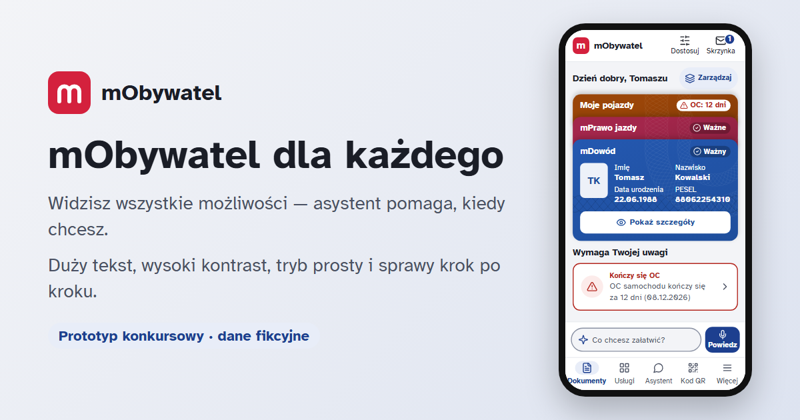

# mObywatel dla każdego

**Prototyp konkursowy, dane fikcyjne.** Klikalny prototyp aplikacji mObywatel przygotowany na konkurs mObywatel Challenge. To nie jest oficjalna aplikacja — nie ma w niej prawdziwych danych, a żadna sprawa nie trafia do urzędu.

## Idea

> **mObywatel dla każdego. Widzisz wszystkie możliwości — asystent pomaga, kiedy chcesz.**

Jedna aplikacja dla młodych i starszych — bez osobnej „wersji dla seniora”. Sprawę można załatwić klikając w Usługach, pisząc albo mówiąc do asystenta. Obie drogi prowadzą do tych samych, widocznych kroków z potwierdzeniem. Zasada asystenta: **AI rozumie, aplikacja prowadzi**.

## Trzy wyróżniki

1. **„Dopasuj do siebie” na pierwszym ekranie** — rozmiar tekstu, motyw (jasny, ciemny, wysoki kontrast), tryb prosty i czytanie na głos, z podglądem na żywo.
2. **Widzisz wszystkie możliwości** — pełna lista usług według sytuacji życiowych, z krótkim opisem i wyszukiwarką. Nic nie jest ukryte za czatem.
3. **Asystent, który prowadzi, a nie tylko gada** — rozpoznaje sprawę i przekazuje do widocznych kroków z licznikiem i potwierdzeniem. Gdy nie rozumie, pokazuje, w czym może pomóc.

## Jak uruchomić

- **W internecie:** otwórz stronę prototypu na GitHub Pages.
- **Na komputerze:** pobierz pliki i otwórz `index.html` dwuklikiem. Serwer nie jest potrzebny. Działa także bez internetu (wtedy z czcionką systemową).

Na start wybierz jedną z trzech osób: **Halina** (71 lat, pierwszy raz w aplikacji), **Tomasz** (38 lat, kierowca) albo **Ola** (24 lata, studentka). Każda ma inne dokumenty i ustawienia.

Skróty w adresie: `?osoba=halina`, `?osoba=tomasz`, `?osoba=ola` (od razu ekran Dokumenty) i `?reset=1` (wszystko od początku).

## Jak przejść 3 sprawy

**A. Zgubione dokumenty** (4 kroki). Wybierz Tomasza → mDowód → „Pokaż szczegóły” → „Zgłoś utratę dowodu”. Albo napisz w polu asystenta „ukradli mi torebkę”. Zaznacz, co zginęło, sprawdź, co zrobimy, potwierdź. Na końcu mDowód ma status „Unieważniony”, a w Skrzynce jest potwierdzenie.

**B. Mój samochód: OC i badanie techniczne** (3 kroki). Wybierz Tomasza → czerwona karta „Kończy się OC” → „Przypomnij mi 7 dni przed terminem” → wybierz SMS albo powiadomienie. Albo zapytaj asystenta „Do kiedy mam OC?”.

**C. Zameldowanie na pobyt stały** (5 kroków). Wybierz Olę → karta „Dokończ zameldowanie” (adres jest już wpisany) → od kiedy → podstawa → potwierdź. Spróbuj złego kodu pocztowego, żeby zobaczyć podpowiedź przy polu.

Warto też zapytać asystenta jako Halina: „Wytłumacz mi pismo” i „Czy ten SMS to oszustwo?”.

## Pliki

| Plik | Co zawiera |
| --- | --- |
| `index.html` | strona aplikacji |
| `style.css` | wygląd, motywy, rozmiary tekstu |
| `app.js` | ekrany, sprawy A, B, C, rozmowa z asystentem |
| `asystent.js` | asystent: jedna sprawa = jeden wpis, rozpoznawanie w `rozpoznajSprawe(tekst)` |
| `dane.js` | fikcyjne osoby, dokumenty, wiadomości i usługi |
| `media/` | ikona i obrazek podglądu linku |
| `SPECYFIKACJA.md`, `POSTEP.md` | specyfikacja i dziennik prac |
| `warianty/` | dokumentacja procesu: wcześniejsze warianty wyglądu (nie są częścią aplikacji) |

Asystent działa bez serwera i bez internetu, wyłącznie na wbudowanych scenariuszach z `asystent.js`.

## Licencja i źródła

- **Kod prototypu:** © 2026 autorka projektu. Udostępniony do oceny w konkursie mObywatel Challenge. Prototyp konkursowy, dane fikcyjne.
- **Ikony:** [Lucide](https://lucide.dev) — licencja ISC (wcześniej Feather, licencja MIT).
- **Czcionka:** [Atkinson Hyperlegible](https://fonts.google.com/specimen/Atkinson+Hyperlegible) (Braille Institute of America) — licencja SIL Open Font License 1.1, wczytywana z Google Fonts.
- **Znak „m” i grafiki kart** (wzory giloszowe, ikony dokumentów, ilustrowane portrety osób, sylwetka auta, tablica rejestracyjna) — własny projekt. Prototyp nie używa godła, oficjalnego logo ani zdjęć prawdziwych osób.
- Nazwa „mObywatel” odnosi się do aplikacji, której ten prototyp dotyczy. Prototyp nie jest produktem administracji publicznej.
